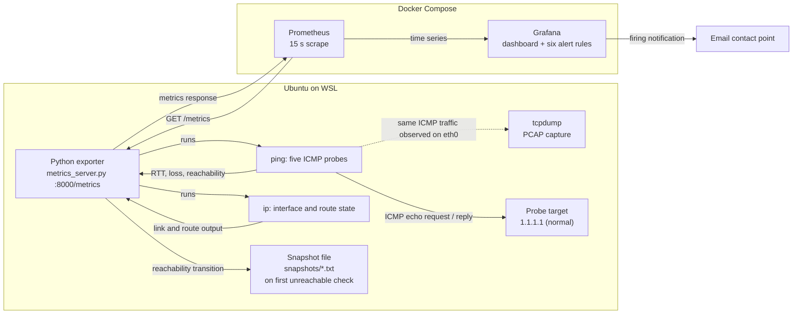
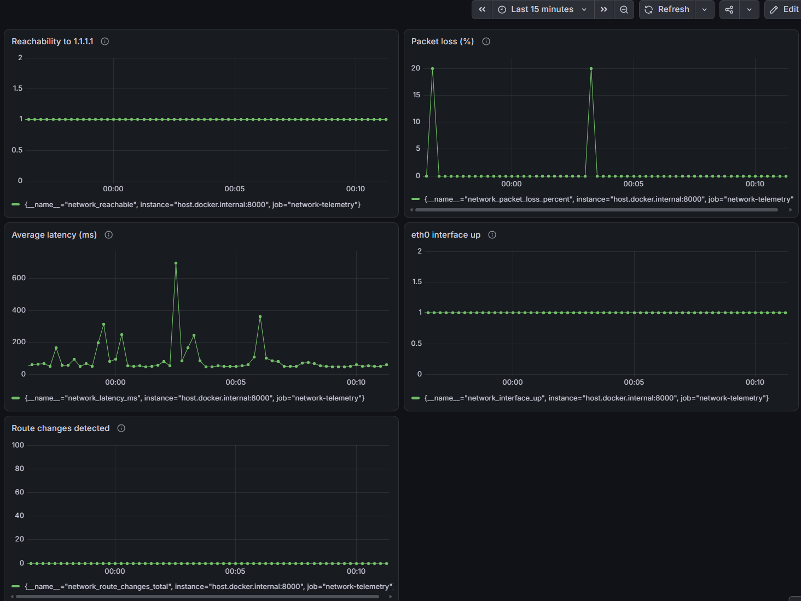
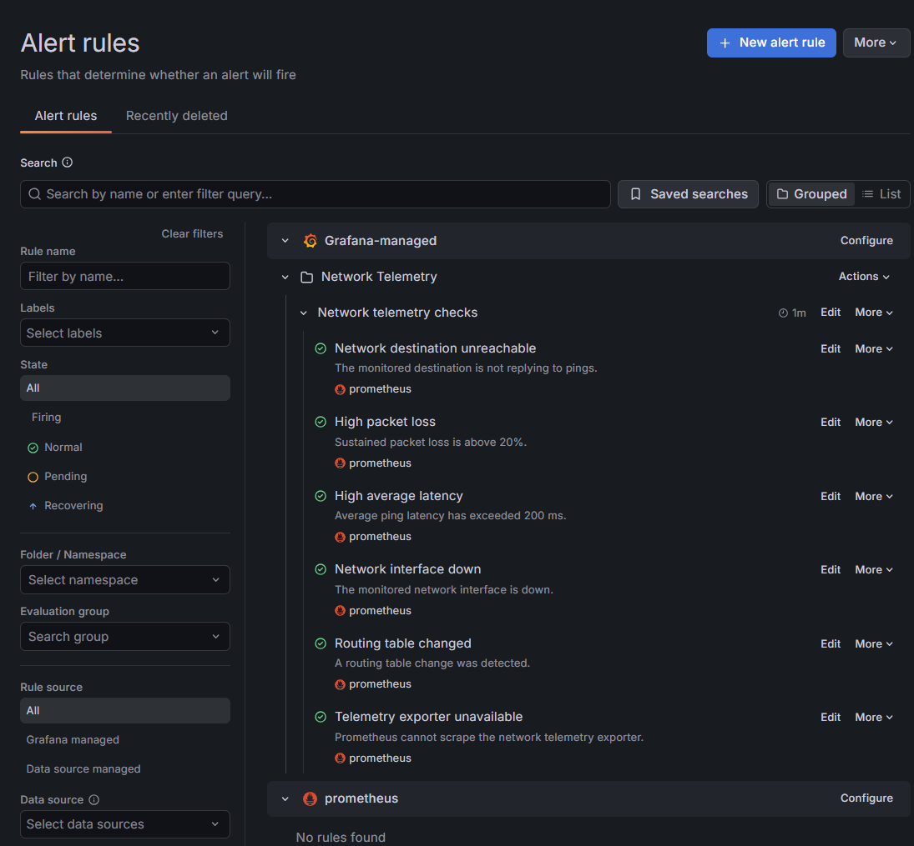

# Network Telemetry and Fault Diagnosis

I built this as a small network-operations lab in Ubuntu on WSL. It follows a connectivity signal from Linux probes, through Prometheus, into Grafana, and into a diagnostic snapshot when the probe first fails.

The scope is intentionally narrow: one IPv4 destination, one interface, and a local WSL environment. The exercise is about collecting useful signals and using them carefully during a failure; it is not a production monitoring service.

## Data path



Solid arrows show checks and metric exchange. The dotted arrow shows tcpdump observing the same ICMP traffic; capture runs separately from the exporter.
## Signals

| Metric | Source | Interpretation |
|---|---|---|
| `network_reachable` | Five ICMP pings to `1.1.1.1` | `1` if at least one reply arrives; otherwise `0` |
| `network_packet_loss_percent` | Ping summary | Loss across five probes, in 20-point increments |
| `network_latency_ms` | Ping RTT summary | Average reply time; NaN if no replies arrive |
| `network_interface_up` | `ip -br link show eth0` | `1` when `eth0` reports UP; otherwise `0` |
| `network_route_changes_total` | Compare `ip route` output between loops | Counter increments when route-table text changes; resets on exporter restart |
| Prometheus `up{job="network-telemetry"}` | Scrape result | `1` when the exporter responds; `0` when a scrape fails |

Each exporter loop sends five pings, parses the ping summary, checks `eth0`, compares the route table, then sleeps ten seconds. The effective loop interval is about fifteen seconds, depending on ping completion time.

## Alert rules

The six rules are in the Grafana folder **Network Telemetry**, group **Network telemetry checks**, evaluated every minute and routed to the `Network Telemetry Email` contact point.

| Rule | Condition | Pending |
|---|---|---:|
| Network destination unreachable | `network_reachable == bool 0` | 1m |
| High packet loss | `network_packet_loss_percent > bool 20` | 2m |
| High average latency | `network_latency_ms > bool 200` | 2m |
| Network interface down | `network_interface_up == bool 0` | 1m |
| Routing table changed | `increase(network_route_changes_total[5m]) > bool 0` | 1m |
| Telemetry exporter unavailable | `up{job="network-telemetry"} == bool 0` | 1m |

The loss and latency values are lab thresholds, not service-level objectives. The five-packet sample is coarse: one missing reply equals 20% loss. Requiring a condition to persist avoids firing on a single brief spike.

## Failure exercise and findings

I used `192.0.2.1` as a controlled no-reply destination. The sample snapshot and packet capture in `evidence/` came from the same short test window.

- The snapshot records three probes sent and zero replies, plus interface and route state.
- The PCAP contains three ICMP echo requests to `192.0.2.1` and no replies.
- `eth0` was UP and a default route was present. That rules out a down local interface or a missing default route in this snapshot; it does not identify where packets were lost beyond the host.
- I also verified the monitor's automatic snapshot on the transition to unreachable, then restored `1.1.1.1` and confirmed the Grafana rules returned to Normal.

A ping result measures ICMP response, not TCP or application health. A silent target may be filtering ICMP, or the failure may be elsewhere in the path. The snapshot narrows the investigation; it does not establish root cause by itself.

## Grafana evidence

### Network health dashboard



In this 15-minute view, reachability stays at `1`, `eth0` stays up, and the route-change counter stays at zero. There are isolated 20% loss samples and latency spikes above 200 ms. The loss alert requires more than 20% for two minutes, and the latency alert requires more than 200 ms for two minutes, so these brief samples do not fire either alert. Reachability and packet loss answer different questions: the destination can reply to most probes while some are still lost.

### Alert rules



All six rules are Normal after the test destination was restored. The empty section under the Prometheus heading is expected: these project rules are Grafana-managed, not Prometheus-managed.

## Run locally

### Requirements

- Windows with Ubuntu WSL 2 and Docker Desktop WSL integration
- Python 3 and `python3-venv` in Ubuntu
- `iproute2`, `iputils-ping`, and `tcpdump` in Ubuntu
- Docker Compose

Install Linux tools from PowerShell:

```powershell
wsl -d Ubuntu-on-D -- bash -lc "sudo apt update && sudo apt install -y python3-venv iproute2 iputils-ping tcpdump"
```

Create the virtual environment and install the pinned Python dependency:

```powershell
wsl -d Ubuntu-on-D -- bash -lc "cd /mnt/d/Downloads/network-telemetry-github-ready && python3 -m venv .venv && .venv/bin/python -m pip install -r requirements.txt"
```

For email alerts, copy `.env.example` to `.env` and enter SMTP settings locally. `.env` is ignored by Git. Never commit mail credentials.

Start Prometheus and Grafana:

```powershell
wsl -d Ubuntu-on-D -- bash -lc "cd /mnt/d/Downloads/network-telemetry-github-ready && docker compose up -d"
```

In a second PowerShell window, start the exporter and leave it running:

```powershell
wsl -d Ubuntu-on-D -- bash -lc "cd /mnt/d/Downloads/network-telemetry-github-ready && .venv/bin/python src/metrics_server.py"
```

Open <http://localhost:9090> for Prometheus, <http://localhost:3000> for Grafana, and <http://localhost:8000/metrics> for the exporter.

## Recreate the Grafana view

On a new Grafana instance, add a Prometheus data source with URL `http://prometheus:9090`, then create a dashboard with one time-series panel per metric below:

| Panel | PromQL |
|---|---|
| Reachability to 1.1.1.1 | `network_reachable` |
| Packet loss (%) | `network_packet_loss_percent` |
| Average latency (ms) | `network_latency_ms` |
| eth0 interface up | `network_interface_up` |
| Route changes detected | `network_route_changes_total` |

Create the six alert rules using the conditions and pending periods in the alert table. Configure the email contact point only after adding your own SMTP settings to `.env`.

The dashboard, contact point, and alert rules shown in the screenshots were created in the local Grafana UI. They are stored in the local Grafana data volume, not provisioned from this repository. The queries and rule conditions are included here so the setup can be recreated. Exporting those Grafana objects as versioned files is a clear next improvement.

## Inspect the evidence

Read the checked-in packet capture from PowerShell:

```powershell
wsl -d Ubuntu-on-D -- bash -lc "tcpdump -nn -tttt -r /mnt/d/Downloads/network-telemetry-github-ready/evidence/correlated-test-capture.pcap"
```

Run a manual diagnostic snapshot from the repository root:

```powershell
wsl -d Ubuntu-on-D -- bash -lc "cd /mnt/d/Downloads/network-telemetry-github-ready && .venv/bin/python src/diagnostic_snapshot.py"
```

Runtime snapshots are written under `snapshots/` and ignored by Git. The sanitized sample snapshot and its matching PCAP are kept under `evidence/`.

## Limits and follow-on work

This version watches one IPv4 destination and one interface. ICMP can be filtered independently of application traffic. Route changes are detected by comparing command output, rather than subscribing to kernel route events. The exporter automatically saves a snapshot on a reachability transition; tcpdump is started separately so packet-capture privileges and capture duration stay explicit.

The next useful engineering steps are to provision the Grafana dashboard and rules from files, add tests around ping parsing and state transitions, monitor multiple destinations, and use route events instead of text comparison.


